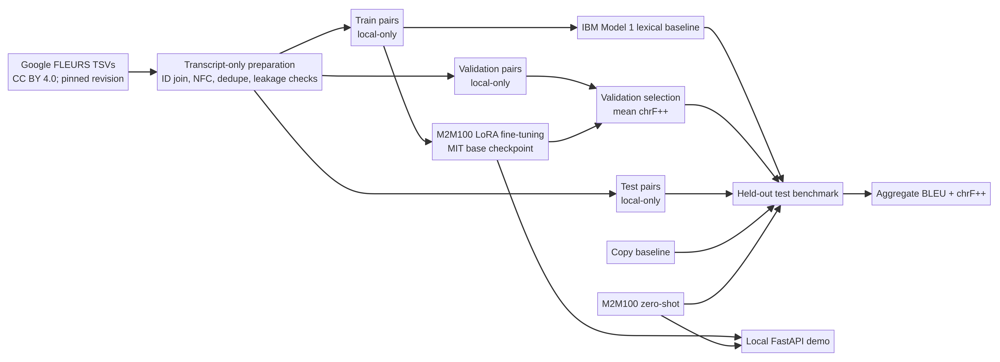

# Ethiopian Language Translation AI

A reproducible, bidirectional English ↔ Amharic sentence-translation benchmark and local inference service. It compares a source-copy baseline, a trained IBM Model 1 lexical baseline, zero-shot M2M100, and a validation-selected LoRA adapter of M2M100. Scores are measured locally on FLEURS and are not presented as production or human-verified translation quality.

**Status:** source code is released at [bereket-web/ethiopian-language-translation-ai](https://github.com/bereket-web/ethiopian-language-translation-ai). The LoRA adapter is separately published at [klohdfhk/ethiopian-language-translation-ai](https://huggingface.co/klohdfhk/ethiopian-language-translation-ai) (revision `9fa0620681f13c729c1fb627d3de440a9de88898`) under CC BY 4.0; its model repository contains the reviewed card, adapter config and weights, with no dataset or base weights. This code repository includes aggregate evaluation only: raw transcript pairs, checkpoints, and local runs remain excluded. CI is configured for Python 3.12; no hosted demo is provided.



## What is built

- Transcript-only data preparation from pinned Google FLEURS Amharic (`am_et`) and English (`en_us`) TSVs. It joins on source sentence ID, deduplicates repeated recordings, excludes conflicting IDs, checks cross-split leakage, and stores only aggregate audit metadata in the repository.
- Bidirectional baselines: unchanged source text and IBM Model 1 token-translation probabilities learned from the training split.
- A multilingual transformer benchmark using MIT-licensed [`facebook/m2m100_418M`](https://huggingface.co/facebook/m2m100_418M), with explicit `en` / `am` target-language IDs.
- Optional PEFT LoRA fine-tuning. Validation chrF++ selects the checkpoint; the test split is not used for tuning.
- A local FastAPI API and browser interface with a 2,000-character limit and prominent research-only warnings.

## Data and permissions

The source is [Google FLEURS](https://huggingface.co/datasets/google/fleurs), pinned to commit `70bb2e84b976b7e960aa89f1c648e09c59f894dd`. Its card declares [CC BY 4.0](https://creativecommons.org/licenses/by/4.0/) and describes the dataset as the speech version of FLORES with n-way parallel sentences. At this revision, joining and deduplicating the Amharic and English transcript files yields **1,407 train pairs, 124 validation pairs, and 296 test pairs**. Repeated recordings with conflicting text are excluded, and sentence IDs do not cross splits. `reports/data_audit.json` records row counts, checksums, the revision, and leakage checks without exposing examples.

The TSVs and derived sentence pairs are local-only and are excluded from Git and any Hugging Face release. The project does not publish a copy of the dataset. The pinned [M2M100 model card](https://huggingface.co/facebook/m2m100_418M) declares MIT but does not fully enumerate rights for every original training corpus; this upstream provenance uncertainty remains a limitation, and the base weights are not bundled. Details and attribution are in [`docs/sources.md`](docs/sources.md).

## Evaluation

The final test benchmark reports corpus BLEU and chrF++ (SacreBLEU, 0–100; higher is better) for both directions, with one reference per input and two-beam decoding. The validation split supports development and model selection; the test split is reserved for the final benchmark. Raw predictions and transcripts remain local under ignored `runs/` and `data/` directories; only aggregate metrics are tracked. Results are language- and domain-specific evidence, not proof of general translation quality.

### Development validation (124 aligned pairs)

These development-only scores are from `reports/validation_benchmark.json`; they are not held-out test results.

| Approach | English → Amharic BLEU / chrF++ | Amharic → English BLEU / chrF++ |
|---|---:|---:|
| Copy baseline | 0.10 / 0.60 | 0.10 / 0.47 |
| IBM Model 1 lexical baseline | 0.38 / 12.51 | 1.20 / 14.84 |
| M2M100 zero-shot | 0.37 / 6.56 | 4.68 / 26.13 |
| M2M100 FLEURS LoRA | 0.45 / 7.94 | 9.34 / 32.53 |

LoRA's mean validation chrF++ is 20.24 versus 16.35 for zero-shot, but English→Amharic remains very weak; IBM Model 1 also beats zero-shot in that direction. These automatic scores do not establish adequate or human-verified translation quality.

### Held-out test benchmark (296 aligned pairs)

The full held-out results below come from `reports/test_benchmark.json`. Scores are corpus BLEU / chrF++ (0–100); mean chrF++ is the unweighted mean of the two directions.

| Approach | English → Amharic BLEU / chrF++ | Amharic → English BLEU / chrF++ |
|---|---:|---:|
| Copy baseline | 0.38 / 0.94 | 0.37 / 0.73 |
| IBM Model 1 lexical baseline | 0.78 / 13.09 | 1.69 / 15.32 |
| M2M100 zero-shot | 0.32 / 6.71 | 6.11 / 27.98 |
| M2M100 FLEURS LoRA | 0.47 / 7.29 | 10.67 / 33.91 |

LoRA mean held-out chrF++ is 20.60 versus 17.34 for zero-shot. The paired sentence-ID bootstrap (1,000 resamples, 296 pairs) estimates a mean gain of +3.26 points (95% CI [+2.57, +3.87]). Directional gains are +0.58 for English→Amharic (95% CI [−0.19, +1.28], which includes zero) and +5.93 for Amharic→English (95% CI [+4.84, +7.10]). The aggregate release gate passes, but the macro gain is driven mainly by Amharic→English; English→Amharic chrF++ remains very low and its interval does not establish improvement.

Before any adapter release, `scripts/bootstrap_eval.py` computes a paired sentence-ID bootstrap interval on the held-out set. Release requires validation and held-out mean chrF++ improvement, a positive lower 95% bound on the paired macro gain, and no more than a 2-point chrF++ decline in either direction.

## Reproduce

Requires Python 3.12 and `uv`; the lock selects CPU-only PyTorch. Dataset text is downloaded to Git-ignored directories; no audio is downloaded.

```bash
uv sync --extra dev
uv run python scripts/prepare_data.py
uv run pytest
uv run ruff check .
uv run python scripts/train.py --epochs 2 --batch-size 16 --gradient-accumulation 1
uv run python scripts/evaluate.py --split test --output reports/test_benchmark.json
uv run python scripts/bootstrap_eval.py --repetitions 1000
uv run python scripts/publish_hf.py --dry-run
uv run uvicorn app:app --host 127.0.0.1 --port 7860
```

Training uses a fixed seed and the training split only, then chooses the best epoch on validation chrF++. The only confirmed local adapter is the best completed checkpoint at epoch 1; although two epochs were requested, the CPU run left no clean final report, so no epoch-2 checkpoint is claimed. The test command compares the same baselines and checkpoints on the complete aligned test set; use `--limit N` only for smoke tests, never for reported metrics.

## API example

```bash
curl -X POST http://127.0.0.1:7860/api/translate \
  -H 'Content-Type: application/json' \
  -d '{"text":"Good morning.","source_language":"en"}'
```

The demo loads the local adapter from `TRANSLATION_ADAPTER_PATH` when present; otherwise it uses the upstream zero-shot checkpoint. Requests are handled in memory and are not intentionally persisted by the app.

## Limitations and intended use

FLEURS text is drawn from read-speech material and is small after Amharic-English ID intersection. One reference per test sentence and automatic lexical-overlap metrics cannot establish semantic adequacy, fluency, factual fidelity, or usefulness in real situations. The data underrepresents spontaneous speech, dialect variation, code-switching, transliteration, current events, and specialized domains. M2M100 quality can vary substantially by direction and sentence length. Do not use this prototype for medical, legal, financial, safety-critical, or certified translation; human review is required.

## License

Original code is MIT-licensed. FLEURS is separately declared CC BY 4.0, and the M2M100 base checkpoint is separately declared MIT; see [`docs/sources.md`](docs/sources.md). The published adapter is released under CC BY 4.0 with FLEURS attribution. No dataset content or base weights are bundled.
